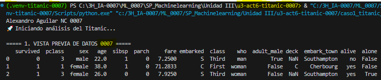
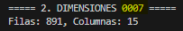
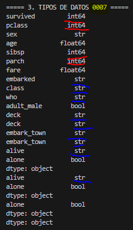
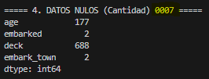
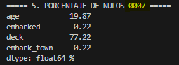
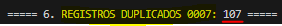
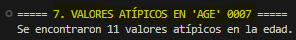
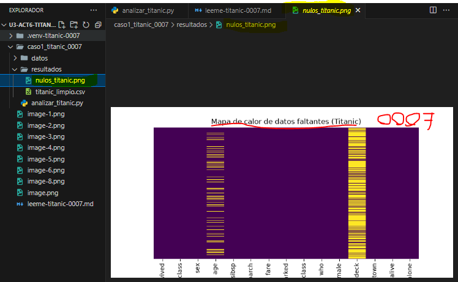
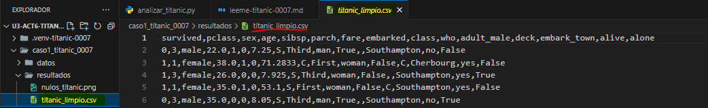

## UIII Act 6  Importación y descripción de datos con Pandas ML
### Alexandro Aguilar NC 0007
## Conceptos Básicos
Antes de tocar el código, es fundamental entender los "4 jinetes del apocalipsis" de los datos:
| 🚨 Problema | 📝 Descripción | 💡 Ejemplo |
| :--- | :--- | :--- |
| **Datos nulos** | Información que no está registrada o es desconocida. | El campo "Edad" está vacío. |
| **Duplicados** | Registros idénticos repetidos, lo que sesga el modelo. | Dos filas con el mismo ID y datos. |
| **Tipos incorrectos** | Datos almacenados con un formato inadecuado. | La edad guardada como texto `"25"` en lugar de número `25`. |
| **Valores atípicos** | Valores extremos que se alejan del comportamiento habitual. | Una edad registrada como `250` años. |

## Librerias a importar 
| **Librería** | 🛠️ Función en esta práctica.

|**Pandas**	| Leer, organizar, limpiar y analizar datos tabulares.

|**NumPy**| Manejar valores numéricos especiales (como NaN para nulos).

|**Matplotlib**|	Crear gráficas base.
Seaborn	Visualizar distribuciones y mapas de calor de forma elegante.
## 1. Vista previa de datos

## 2. Dimensiones

## 3. Tipo de datos

## 4. Datos nulos (Cantidad)

## 5. Porcentaje de nulos

## 6. Registros duplicados

## 7. Valores atipicos

## Grafica de nulos con mapa de calor

## Dataset limpio

